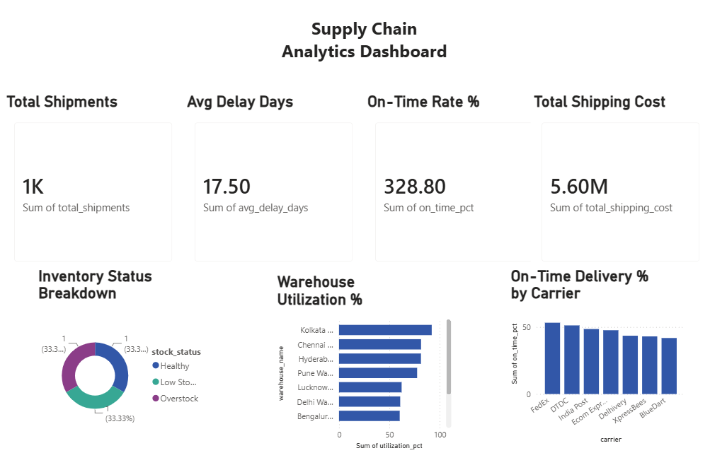

# Supply Chain Analytics Dashboard

An end-to-end supply chain analytics project tracking inventory health,
supplier performance, and shipment delays across warehouses and suppliers.

## Dashboard Preview


## Tech Stack
- **Python** — Data generation & analysis (Pandas, Faker, SQLAlchemy)
- **PostgreSQL** — Relational database with 6 tables
- **Power BI** — Interactive 5-page dashboard
- **Excel** — Exported analytical reports

## Project Structure
supply-chain-analytics/
├── data/                        # Generated CSV and Excel files
├── sql/
│   ├── 01_create_tables.sql     # Database schema
│   └── 02_load_data.sql         # Data loading script
├── python/
│   ├── load_to_postgres.py      # Load CSVs to PostgreSQL
│   └── analysis.py              # Business metrics analysis
├── generate_data.py             # Synthetic data generation
└── Supply_Chain_Dashboard.pbix  # Power BI dashboard

## Dataset Overview
| Table | Rows | Description |
|---|---|---|
| Warehouses | 10 | Locations, capacity, utilization |
| Suppliers | 50 | Country, reliability score, defect rate |
| Products | 300 | 6 categories, cost, reorder levels |
| Inventory | 300 | Stock status, days of supply |
| Purchase Orders | 2,000 | Procurement transactions |
| Shipments | 1,500+ | Delivery tracking, delays, carriers |

## Key Business Insights
- Only 28.8% of shipments delivered on time — major logistics gap identified
- Average shipment delay of 1.9 days across all carriers
- Multiple products flagged for critical reorder urgency
- Warehouse utilization imbalances detected across 10 locations

## Dashboard Pages
1. **Executive Summary** — KPI cards, inventory health, carrier performance
2. **Inventory Analysis** — Stock status, reorder urgency, days of supply
3. **Supplier Performance** — On-time rates, defect rates, scorecards
4. **Order & Delivery Tracking** — Monthly trends, delay distribution
5. **Warehouse Operations** — Capacity vs usage, utilization levels

## How to Run
1. Install dependencies:
```bash
   pip install pandas faker sqlalchemy psycopg2-binary openpyxl
```
2. Generate data:
```bash
   python generate_data.py
```
3. Create PostgreSQL database `supply_chain_db` and run `sql/01_create_tables.sql`
4. Load data:
```bash
   python python/load_to_postgres.py
```
5. Run analysis:
```bash
   python python/analysis.py
```
6. Open `Supply_Chain_Dashboard.pbix` in Power BI Desktop